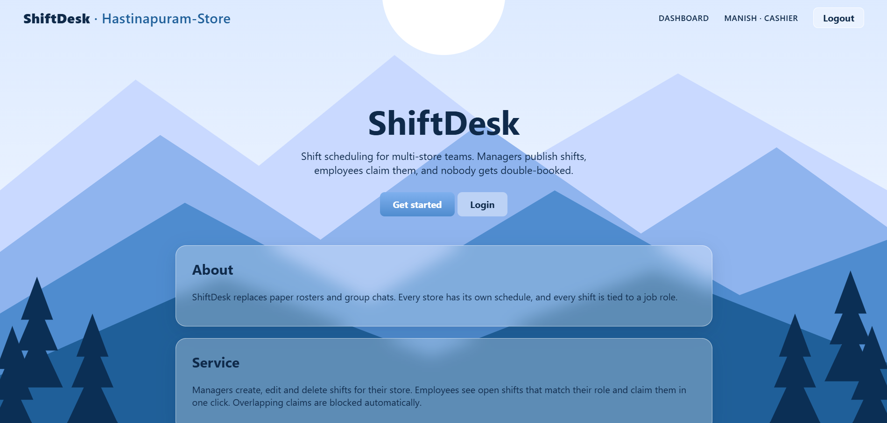

# ShiftDesk

A multi-store employee shift scheduling web app. Managers publish shifts for their store, employees claim the open shifts that match their job role, and the system makes sure nobody is double-booked.



## Features

- **Registration and login** with JWT authentication and BCrypt-hashed passwords
- **Three roles:** Admin, Manager and Employee (Cashier, Stock Clerk, Supervisor)
- **Managers** create, edit, delete and release shifts for their own store
- **Employees** see their store's shifts and claim open ones that match their role
- **Admin** promotes registered users to manager, creates stores, and lists all users. Nobody can pick the manager role while registering
- **Conflict protection:** a shift can only be claimed by one person, even when several people click at the same moment
- Frosted-glass React UI with a landing page, login, register, dashboard and admin pages. The store name shows in the header after login

## Tech stack

| Layer | Technology |
|---|---|
| Back end | Java 25, Spring Boot 4, Spring Web, Spring Security, Spring Data JPA (Hibernate) |
| Auth | JWT (jjwt), BCrypt |
| Database | MySQL 8 |
| Front end | React 18, Vite, React Router, plain CSS |
| Build | Maven, npm |

## How it works

- **Roles are checked on every request.** The JWT only identifies the user. The role is read from the database each time, so a promotion takes effect immediately.
- **Optimistic locking.** `Shift` has a `@Version` field. If two employees claim the same shift at once, one update fails and that user gets a 409 response.
- **Claim rules** (enforced in `ShiftService`): the shift must be open, in the employee's own store, match their role, and not overlap another shift they already hold.
- **Claimed shifts are protected.** A manager must release a claimed shift before editing or deleting it, so an employee's shift never changes under them.
- **Credentials are stored apart from employee data** (`Account` entity), so a password hash can never leak through a shift or employee response.

## Project structure

```
shiftdesk/
├── shiftdesk-api/                 Spring Boot REST API (port 8080)
│   └── src/main/java/com/shiftdesk/
│       ├── controller/            REST endpoints
│       ├── service/               Business rules and transactions
│       ├── repository/            Spring Data JPA repositories
│       ├── entity/                JPA entities (Store, Employee, Account, Shift)
│       ├── dto/                   Request and response records
│       ├── security/              JWT service, filter, Spring Security config
│       ├── exception/             Global error handling
│       └── config/                CORS config and data seeder
└── shiftdesk-ui/                  React + Vite front end (port 5173)
    └── src/
        ├── pages/                 Landing, Login, Register, Dashboard, Admin
        ├── AuthContext.jsx        Login state
        └── api.js                 Fetch helper that attaches the JWT
```

## Getting started

### Prerequisites

- JDK 25 (or the version set in `pom.xml`)
- Maven
- MySQL 8, running locally
- Node.js 18 or newer

### 1. API

1. Copy `shiftdesk-api/src/main/resources/application.properties.example` to `application.properties` in the same folder.
2. Edit it: set your MySQL username and password, and set `shiftdesk.jwt.secret` to your own random text of at least 32 characters.
3. Start the API from your IDE by running `ShiftDeskApplication`, or from the `shiftdesk-api` folder:
   ```
   mvn spring-boot:run
   ```

The database and tables are created automatically on first start, along with two sample stores (Downtown, Uptown) and an admin account.

### 2. UI

```
cd shiftdesk-ui
npm install
npm run dev
```

Open http://localhost:5173.

### Default admin login

| Email | Password |
|---|---|
| `admin@shiftdesk.com` | `Admin@123` |

**Change this password** before using the app for anything beyond local testing.

## Trying it out

1. Log in as the admin.
2. Open a private window and register two employees in the same store (for example, two Cashiers).
3. As admin, click **Make manager** on one of them.
4. As the manager, publish a shift for the Cashier role.
5. As the other employee, claim it. Try claiming a second, overlapping shift to see the conflict rule.

## API overview

| Method | Endpoint | Who | Purpose |
|---|---|---|---|
| POST | `/api/auth/register` | Anyone | Create an account and sign in |
| POST | `/api/auth/login` | Anyone | Sign in and get a JWT |
| GET | `/api/stores` | Anyone | List stores |
| GET | `/api/stores/{id}/shifts` | Signed-in user | List shifts for their own store (admin: any store) |
| POST | `/api/shifts` | Manager | Publish a shift |
| PUT | `/api/shifts/{id}` | Manager | Edit an unclaimed shift |
| DELETE | `/api/shifts/{id}` | Manager | Delete an unclaimed shift |
| POST | `/api/shifts/{id}/release` | Manager | Remove the claim on a shift |
| POST | `/api/shifts/{id}/claim` | Signed-in user | Claim an open shift |
| GET | `/api/admin/users` | Admin | List all users |
| POST | `/api/admin/users/{id}/promote` | Admin | Make a user a manager |
| POST | `/api/admin/stores` | Admin | Create a store |

Protected endpoints expect an `Authorization: Bearer <token>` header.

## Roadmap

- Concurrency test (several threads claiming one shift) and service-layer unit tests
- Secrets from environment variables instead of the properties file
- Private entity fields with DTO responses
- Flyway migrations
- Swagger / OpenAPI documentation
- Password change, and an employee "My shifts" view

## Author

Manohar Gurrampati